# Exploratory Data Analysis: MAGFiLO 1.0 (Kaggle 2026)

Every number below is computed by [`eda.py`](eda.py) from the competition data. Running it also writes all the
numbers to `stats.json`, which is not committed. Figures are in [`figures/`](figures/); the two that render competition images
(`14_examples.png`, `15_ring_example.png`) are generated locally but not committed. To reproduce:

```bash
pip install numpy pandas matplotlib opencv-python-headless
python EDA/eda.py --data /path/to/MAGFiLO_1.0_Kaggle_2026
```

**Conventions.** Pixel sizes are at the native 2048 × 2048 resolution unless stated. A *record* is one entry in the
COCO `images` list: one annotator's annotation of one physical image. A *filament* is one polygon. "Train" and
"test" refer to the competition folders.

## Contents

1. [Inventory](#1-inventory)
2. [Time coverage](#2-time-coverage)
3. [Observing stations](#3-observing-stations)
4. [Records and annotators](#4-records-and-annotators)
5. [Filaments per record](#5-filaments-per-record)
6. [Filament size and shape](#6-filament-size-and-shape)
7. [Category labels](#7-category-labels)
8. [Solar disk geometry](#8-solar-disk-geometry)
9. [Image intensity](#9-image-intensity)
10. [Where filaments are on the disk](#10-where-filaments-are-on-the-disk)
11. [Foreground fraction](#11-foreground-fraction)
12. [Agreement between annotators](#12-agreement-between-annotators)

---

## 1. Inventory

| Item | Count |
|---|---:|
| Training images (`train/train_images`) | 707 |
| Test images (`test/test_images`) | 180 |
| Annotation records | 1,154 |
| Filament polygons | 8,199 |
| Distinct annotators (record-id prefix) | 37 |

- Every image, train and test, is **2048 × 2048** grayscale JPEG.
- Every training image has at least one record. **No record is empty**: each has at least one filament.
- Every polygon is a **single part** (one ring), and `iscrowd` is 0 for all 8,199.
- Each annotation carries `segmentation`, `area`, `bbox`, `spine`, `category_id`, `iscrowd`, `image_id` and `id`.
- Dates: train **2011-01-09 to 2022-08-03**, test **2011-01-20 to 2022-07-28**.

## 2. Time coverage

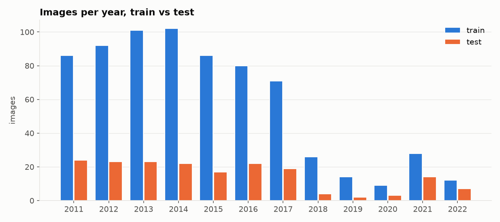

| Year | 2011 | 2012 | 2013 | 2014 | 2015 | 2016 | 2017 | 2018 | 2019 | 2020 | 2021 | 2022 |
|---|---:|---:|---:|---:|---:|---:|---:|---:|---:|---:|---:|---:|
| Train | 86 | 92 | 101 | 102 | 86 | 80 | 71 | 26 | 14 | 9 | 28 | 12 |
| Test | 24 | 23 | 23 | 22 | 17 | 22 | 19 | 4 | 2 | 3 | 14 | 7 |

- Train and test cover the same 12 years.
- 2018–2020 have the fewest images: 49 train, 9 test.

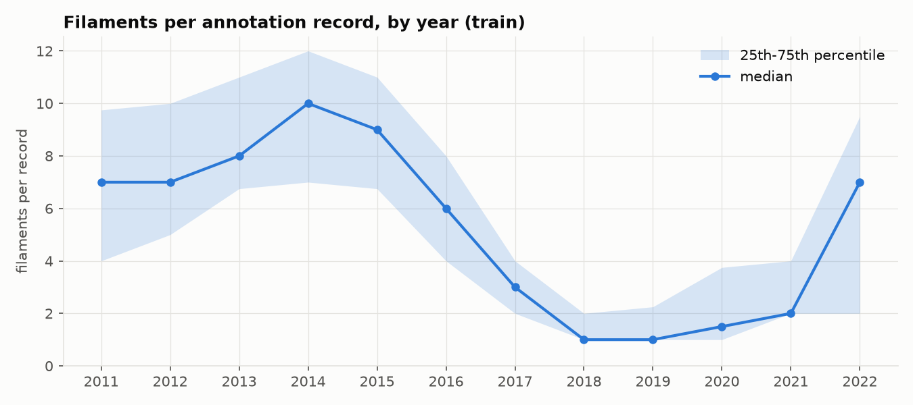

- The median number of filaments per record changes by year: **7, 7, 8, 10, 9, 6, 3, 1, 1, 1.5, 2, 7** for
  2011 through 2022.
- It peaks in 2014 (median 10) and is lowest in 2018–2019 (median 1).

**Images per day.** The 707 training images fall on 656 distinct dates: 606 dates have one image, 49 have two and
1 has three. Between consecutive training dates the median gap is 3 days, the longest is 155 days, and 23.5% of
the gaps are exactly 1 day.

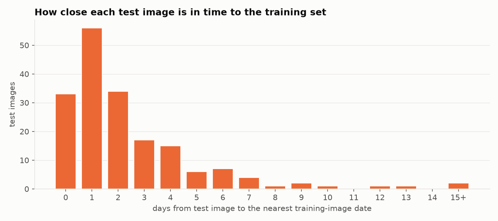

For each test image, the gap is measured from its date to the nearest date with a training image:

| Gap (days) | 0 | 1 | 2 | 3 | 4 | 5–7 | 8–13 | 25 | 54 |
|---|---:|---:|---:|---:|---:|---:|---:|---:|---:|
| Test images | 33 | 56 | 34 | 17 | 15 | 17 | 6 | 1 | 1 |

- **33 test images (18%)** are on a date that also has a training image.
- **89 (49%)** are within 1 day of one, and **140 (78%)** within 3 days.

## 3. Observing stations

The 15th character of each file name is a station code. There are six: B, C, L, M, T and U.

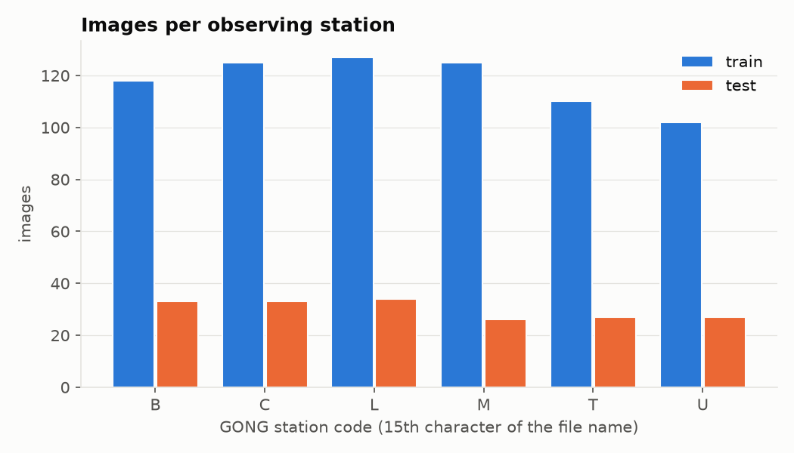

| Station | B | C | L | M | T | U |
|---|---:|---:|---:|---:|---:|---:|
| Train | 118 | 125 | 127 | 125 | 110 | 102 |
| Test | 33 | 33 | 34 | 26 | 27 | 27 |

Each station's images are taken at different UTC hours (from the file-name timestamp):

| Station | Hours (UTC) seen |
|---|---|
| B | 13–20, 22–23 |
| C | 10–15, 17–22 |
| L | 0, 2–8, 22–23 |
| M | 0, 3, 16–20, 22–23 |
| T | 7–14, 16, 18 |
| U | 1–8, 11 |

## 4. Records and annotators

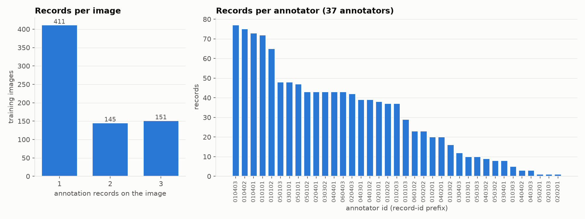

| Records on the image | 1 | 2 | 3 |
|---|---:|---:|---:|
| Training images | 411 | 145 | 151 |

- **296 training images (42%)** have more than one record.
- The 37 annotators made between **1 and 77** records each (median 37).
- The median number of filaments per record differs by annotator, from **1.5 to 11**.

## 5. Filaments per record

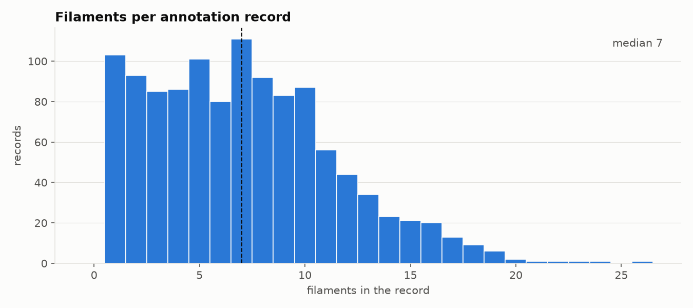

- Filaments per record: min **1**, quartiles **4 / 7 / 10**, max **26**, mean 7.1.

## 6. Filament size and shape

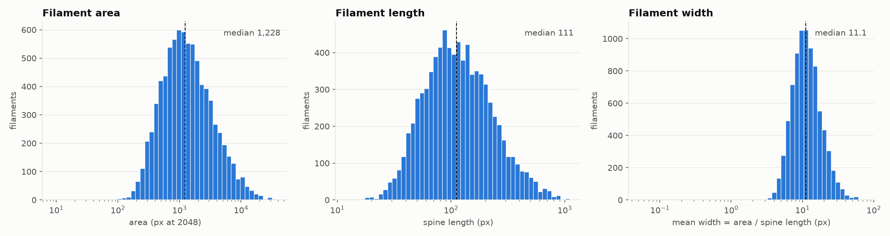

Width is estimated as polygon area divided by spine length. (The spines come from the annotation file. The
competition rules do not allow them as a training signal; here they are only used to measure the data.)

| Measure | 5th pct | 25th | Median | 75th | 95th | Max |
|---|---:|---:|---:|---:|---:|---:|
| Area (px) | 317 | 670 | 1,228 | 2,438 | 6,947 | 37,739 |
| Spine length (px) | 41 | 71 | 111 | 182 | 387 | 1,105 |
| Mean width (px) | 5.6 | 8.3 | 11.1 | 15.2 | 25.5 | 70.2 |
| Polygon vertices | 19 | 36 | 60 | 100 | 201 | 707 |

- The smallest polygon has an area of 9 px.
- Share of filaments with area below a size cutoff: **0.8% under 200 px**, **9.5% under 400 px**, **31.8% under 800 px**.
- Scale reference: a median width of 11.1 px at 2048 becomes about 5.5 px at 1024 and 2.8 px at 512.

## 7. Category labels

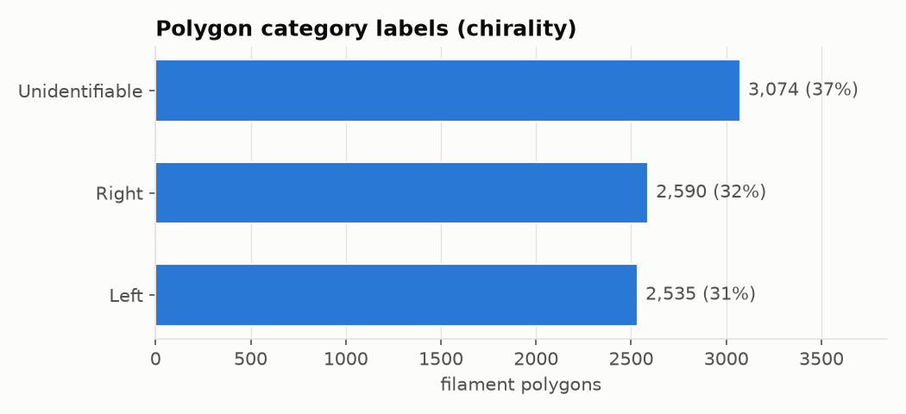

The file defines four categories: Left, Right, Unidentifiable and Ambiguous. **Ambiguous is never used.**

| Category | Polygons | Share | Median area (px) | Median spine length (px) |
|---|---:|---:|---:|---:|
| Left | 2,535 | 31% | 1,438 | 135 |
| Right | 2,590 | 32% | 1,524 | 139 |
| Unidentifiable | 3,074 | 37% | 869 | 78 |

Unidentifiable polygons are smaller: their median area and spine length are 56–60% of the Left and Right
values. The rules do not allow category labels as a training signal.

## 8. Solar disk geometry

The solar limb is found with a Hough circle fit on a 512 px copy of every image (train and test, 887 images). The
fit is reported at 2048 px, so the fitted centre has a 4 px resolution. It found a circle on **all 887** images.

- **Disk radius: 890–913 px** (median 902). The station medians are all between 901 and 903 px.
- **Disk centre: 1010–1034 px** in both x and y (median 1022, 1022). The image centre is 1024.

- **The region outside the limb is not uniformly black.** In the annulus from 1.02 to 1.10 radii, the mean pixel
  value has a median of **31** (5th–95th percentile 19–80, max 127). It is above 20 in 90% of images and above 60
  in 13%.
- In **96 images (71 train, 25 test)**, an Otsu threshold puts this ring in the foreground, which makes the
  "disk" more than 5% wider than the limb. Its radius goes up to 1,032 px.
  - By station: T 42, B 29, M 8, U 8, C 6, L 3.
  - These images occur in every year from 2011 to 2022.

## 9. Image intensity

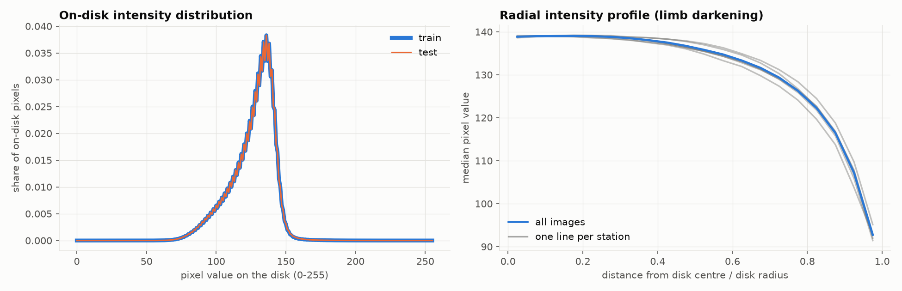

- **On-disk pixel values** (inside 0.98 radii, 512 px copies) have nearly the same distribution in train and test:

  | | Median of per-image mean | 5th–95th pct | Median of per-image std |
  |---|---:|---:|---:|
  | Train | 126.3 | 120.8–129.3 | 14.8 |
  | Test | 126.4 | 121.0–129.9 | 14.9 |

- **Limb darkening:** the median pixel value falls from **138.9** near the disk centre to **92.7** at
  0.95–1.0 radii, a drop of 33%. All six stations show the same shape.

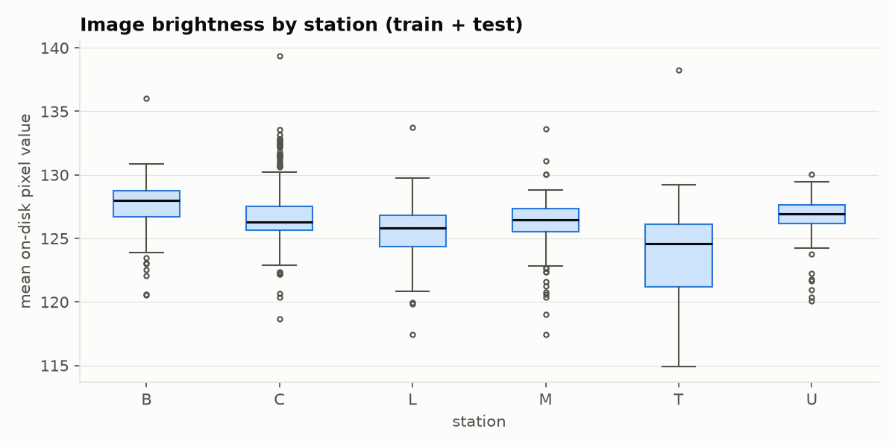

- The median on-disk brightness by station ranges from **124.6 (T) to 128.0 (B)**. Station T has the widest spread.

## 10. Where filaments are on the disk

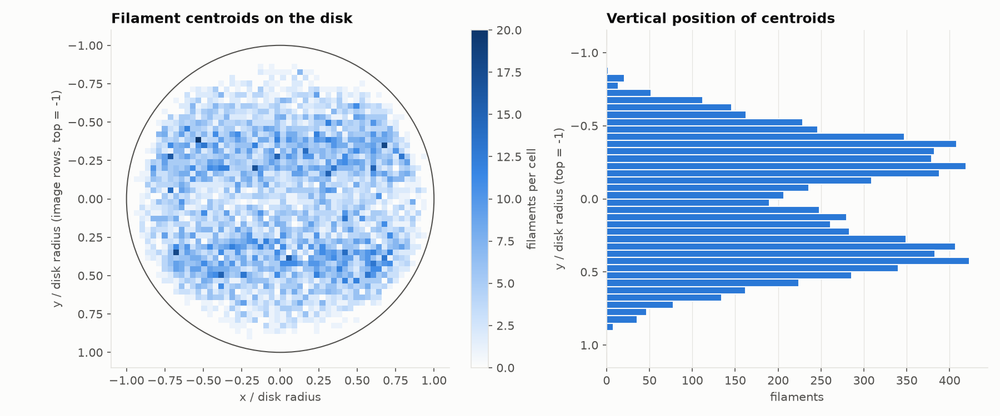

Positions are each polygon's vertex centroid, measured relative to the fitted disk centre and radius. Here "y" is
the image row axis.

- **All 8,199 centroids lie inside the disk.** Their distance from the centre runs from 0.01 to 0.96 radii
  (median 0.58, 95th percentile 0.85).
- **49.5%** are in the upper half of the image.
- **64.3%** lie between 0.2 and 0.6 radii above or below the centre row. Only **10.7%** lie within 0.1 radii of it.

## 11. Foreground fraction

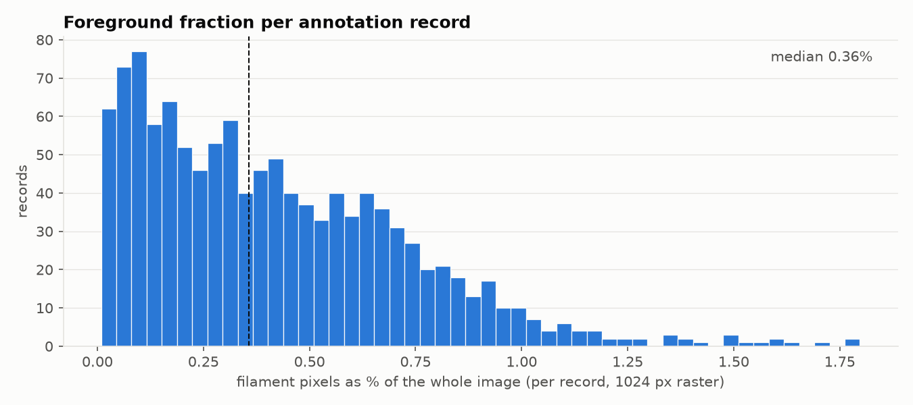

Each record's polygons are rasterized at 1024 px.

| Filament pixels as a share of | 5th pct | Median | 95th pct | Max |
|---|---:|---:|---:|---:|
| The whole image | 0.04% | **0.36%** | 0.97% | 1.80% |
| The solar disk | 0.07% | **0.59%** | 1.59% | 2.99% |

## 12. Agreement between annotators

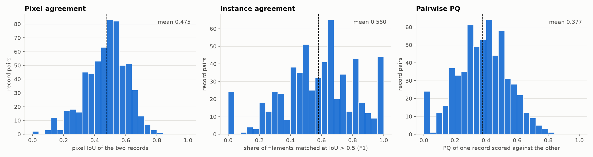

The 296 images with two or three records give **598 record pairs**. Each pair is compared at 1024 px.

| Measure | Mean | Median | 5th–95th pct |
|---|---:|---:|---:|
| Pixel IoU between the two records | 0.475 | 0.494 | 0.23–0.67 |
| Instance F1 (filaments matched at IoU > 0.5) | — | 0.594 | 0.18–1.00 |
| PQ of one record scored against the other | **0.377** | 0.383 | 0.11–0.64 |
| Smaller / larger filament count | — | 0.75 | 0.33–1.00 |

- Among filaments that are matched, the mean IoU is **0.647**.
- Some pairs share **no** filament matched at IoU > 0.5: the bar at 0 in the middle and right panels.
